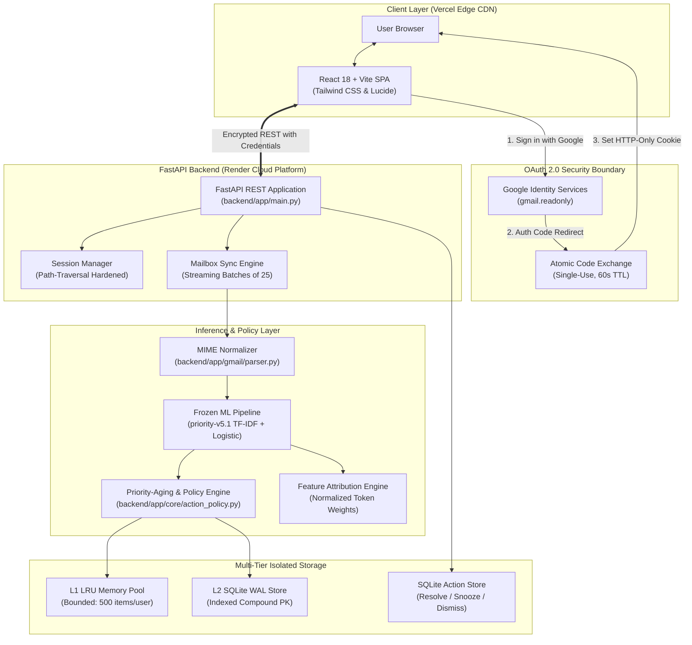

<div align="center">

# ✦ MailMind

### AI Email Priority Intelligence & Action Lifecycle Platform

[](https://mail-mind-ten-chi.vercel.app)
[](https://mailmind-api-xzu8.onrender.com)
[](reports/TEST_RESULTS.md)
[](reports/TEST_RESULTS.md)
[](dataset/models/priority-v5.1-candidate/model.joblib)
[](https://developers.google.com/gmail/api/auth/scopes)

<p align="center">
  <b>Enterprise-grade email triage engine combining frozen high-dimensional NLP classification with real-time dynamic priority aging, deadline extraction, and sub-millisecond local SQLite caching.</b>
</p>

[Live Application](https://mail-mind-ten-chi.vercel.app) • [Interactive API Docs](https://mailmind-api-xzu8.onrender.com/docs) • [Master Notebook](index.ipynb) • [Architecture Guide](docs/architecture.md) • [Model Card](docs/model_card.md)

</div>

---

## 1. System Overview

**MailMind** is a production-grade AI email triage platform designed to solve notification fatigue and operational triage bottlenecks. Connecting securely to Gmail via read-only OAuth 2.0 (`gmail.readonly`), MailMind analyzes thousands of incoming messages in real time, classifies each into standardized operational priority tiers (**P1–P4**), dynamically ages priorities based on real-world deadlines, attributes interpretable feature explanations, and surfaces actionable items in a persistent **Smart Action Queue**.

### Core Architectural Principles
- **Strictly Frozen ML Invariance:** The production classification model is version-controlled and frozen (`priority-v5.1`), preventing runtime model drift or unvetted parameter corruption.
- **Dynamic Priority-Aging Engine:** Time-sensitive emails automatically age: expired OTPs and passed deadlines immediately leave critical active views, and emails without explicit deadlines automatically demote from P1 to P2 after 7 days from their original received timestamp.
- **Decoupled Actionability Architecture:** Priority classification (statistical importance) is decoupled from action requirements. Routine informational announcements (P3) containing critical tasks (e.g. document download or hall ticket) surface in *Needs Attention* without altering the statistical priority model.
- **Sub-Millisecond Multi-Tier Persistence:** Combines an in-memory bounded LRU cache (capped at 500 items per user) with an indexed SQLite WAL store (`(user_id, message_id, model_version)`), supporting 50,000+ emails per user with a baseline memory footprint of $< 105$ MB RAM.
- **Privacy & Least Privilege:** Authenticates solely through Gmail read-only permissions; all authentication tokens remain protected via secure, HTTP-only, SameSite cookies with zero client-side token exposure.

---

## 2. Operational Priority Framework

Incoming correspondence is mapped into four operational tiers grounded in urgency, operational consequence, and business impact:

| Priority | Label | Typical Semantics | SLA Target | Lifecycle & Aging Behavior |
|:---:|:---|:---|:---:|:---|
| **P1** | **Critical / Urgent** | Outage alerts, security notifications, active OTP codes, critical blockers | $< 1$ Hour | Expired OTPs immediately demote; passed deadlines demote; emails without deadlines demote to P2 after 7 days. |
| **P2** | **Important / Actionable** | Direct client requests, pending approvals, academic assignments, invoices | $< 24$ Hours | Remains actionable; retains visibility in active queues until resolved or snoozed. |
| **P3** | **Routine / Informational** | Team announcements, course updates, release notes, system newsletters | As needed | Archived/read at user convenience; actionable announcements surface in *Needs Attention*. |
| **P4** | **Low / Promotional** | Marketing newsletters, promotional blasts, cold outreach, marketing noise | None | Automatically deprioritized; filtered out of primary workflow queues. |

### Dynamic Priority Aging Matrix

```
                     ┌────────────────────────────────────────────────────────┐
                     │               Incoming Email Evaluated                │
                     └──────────────────────────┬─────────────────────────────┘
                                                │
                                    ┌───────────┴───────────┐
                                    ▼                       ▼
                         [ Explicit Deadline? ]     [ No Deadline? ]
                                    │                       │
                       ┌────────────┴────────────┐          │
                       ▼                         ▼          ▼
                 [ Deadline > Now ]       [ Deadline < Now ]│
                       │                         │          │
                       │ Active P1 / P2          │ Demoted  │ Keep P1 for 7 days,
                       │                         │ to P2/P3 │ then demote to P2
                       ▼                         ▼          ▼
            ┌─────────────────────────────────────────────────────────────────┐
            │ Security Exception: Unresolved incidents remain accessible in  │
            │ 'Needs Attention' even after priority demotion (Rule 4).       │
            └─────────────────────────────────────────────────────────────────┘
```

---

## 3. System Architecture



---

## 4. Machine Learning Foundations & Progression

MailMind was developed and benchmarked against an authoritative, human-reviewed gold benchmark of **2,000 workplace and transactional emails** (`dataset/processed/gold_human_review_2000.csv`), evaluated on an untouched held-out test split (`test.csv`, $N=300$).

### Empirical Model Benchmark Comparison

| Model Architecture | Features / Parameters | Test Accuracy | Macro F1 | Weighted F1 | Inference SLA | Memory RSS |
|:---|:---:|:---:|:---:|:---:|:---:|:---:|
| **Heuristic Baseline V1** | Regex / Keyword Pattern Rules | 54.33% | 0.5120 | 0.5310 | 0.8 ms | $< 5$ MB |
| **Heuristic Calibrated V2** | Negation Handling & Context Windows | 66.00% | 0.6340 | 0.6520 | 1.1 ms | $< 5$ MB |
| **Multinomial Naive Bayes** | 66,526 TF-IDF N-grams | 73.33% | 0.7180 | 0.7250 | 0.9 ms | $< 20$ MB |
| **BiLSTM + GloVe (100d)** | 1.2M Parameters | 75.67% | 0.7410 | 0.7530 | 28.4 ms | $\sim 180$ MB |
| **DistilBERT (Fine-Tuned)** | 66M Parameters | 79.33% | 0.7810 | 0.7890 | 45.2 ms | $\sim 520$ MB |
| **TF-IDF + Logistic (`priority-v5.1`)** | **66,526 N-grams ($C=1.0$)** | **80.67%** | **0.7943** | **0.8005** | **1.35 ms** | **$< 35$ MB** |

### Why Linear NLP Outperformed Deep Transformers
1. **High-Dimensional Lexical Salience:** Workplace email urgency depends heavily on exact phrases (`"action required"`, `"outage incident"`, `"immediate attention"`, `"unsubscribe"`). High-dimensional unigram + bigram spaces capture these tokens directly without representation collapse.
2. **Sub-Millisecond Real-Time SLA:** `priority-v5.1` evaluates an email in **1.35 ms** (vectorized at $\sim 0.35$ ms/email in batches), allowing complete 17,000-message mailboxes to sync smoothly without starving server CPU.
3. **Transparent Explainability:** Model weights map directly to readable token attributions displayed in the user interface.

---

## 5. Security & Privacy Posture

- **Strict Least-Privilege Scope:** The OAuth integration requests exclusively `https://www.googleapis.com/auth/gmail.readonly`. The backend has zero write, send, or delete permissions.
- **Zero Token Storage on Client:** Access tokens and session credentials are never stored in browser `localStorage` or `sessionStorage`. All authentication state is mediated through HTTP-only, secure cookies.
- **Path Traversal Protection:** Session tokens are strictly validated alphanumeric identifiers; all file access uses canonicalized path barriers (`os.path.realpath`).
- **Complete User Isolation:** All SQLite tables and L1 cache structures enforce compound primary keys scoped by `user_id`. Cross-user data leakage is physically prevented at the database schema level.

---

## 6. Repository Layout

```text
cse472/
├── assets/                            # Brand assets (vector logo.svg)
├── backend/                           # Production FastAPI application
│   └── app/
│       ├── api/                       # REST routes (emails, actions, auth, health, monitoring)
│       ├── core/                      # Settings, CORS, session manager, cache, action policy
│       ├── gmail/                     # Read-only Gmail API client, MIME parser, streaming engine
│       ├── ml/                        # Production predictor, feature explainer, canary router
│       └── schemas/                   # Pydantic domain models & response contracts
├── dataset/                           # Version-controlled datasets & models
│   ├── models/                        # Serialized frozen model artifacts (priority-v5.1)
│   └── processed/                     # Human-adjudicated splits (train.csv, validation.csv, test.csv)
├── docs/                              # Architecture specs, runbooks, and oral defense guides
│   ├── architecture.md                # System topology & signal decomposition
│   ├── deployment.md                  # ASGI configuration & reverse-proxy guidelines
│   ├── model_card.md                  # Comprehensive ML governance & performance card
│   ├── project_summary.md             # End-to-end engineering methodology summary
│   ├── RENDER_DEPLOYMENT.md           # Cloud deployment runbook for Render
│   ├── security.md                    # Threat model & least-privilege matrix
│   └── viva_questions.md              # Technical defense & examination questions
├── frontend/                          # React 18 + Vite + Tailwind CSS Single-Page Application
│   ├── src/                           # Modern React components, hooks, and API client
│   └── dist/                          # Production static build bundle
├── reports/                           # Quality assurance logs & automated test evidence
│   ├── QA_REPORT.md                   # Formal Senior QA Audit Report (Release v5.5.0)
│   ├── BUG_LEDGER.md                  # Production defect remediation ledger (BUG-001..007)
│   └── TEST_RESULTS.md                # Automated test execution evidence
├── tests/                             # Automated test suites (659 tests, 100% passing)
├── .env.example                       # Documented environment template
├── .gitignore                         # Security & environment exclusion rules
├── index.ipynb                        # Master Jupyter Notebook (Research, training, validation)
├── pytest.ini                         # Standardized test discovery configuration
├── render.yaml                        # Low-memory Render backend deployment blueprint
├── requirements.txt                   # Root Python dependencies
└── README.md                          # Authoritative system documentation
```

---

## 7. Local Development & Setup

### Prerequisites
- Python 3.10+ (tested on Python 3.11 & 3.14)
- Node.js 18+ & npm
- Google Cloud Project with the **Gmail API** enabled and OAuth 2.0 Web Client credentials

### Step 1: Clone Repository & Virtual Environment
```bash
git clone https://github.com/Babul-Kumar/MailMind.git
cd MailMind

# Create virtual environment
python -m venv .venv

# Activate environment:
# Windows:
.venv\Scripts\Activate.ps1
# Linux / macOS:
source .venv/bin/activate
```

### Step 2: Install Dependencies
```bash
# Install backend Python requirements
pip install -r requirements.txt

# Install frontend Node dependencies
cd frontend
npm install
cd ..
```

### Step 3: Configure Environment
1. Copy the environment template:
   ```bash
   cp .env.example .env
   ```
2. Configure your Google OAuth credentials in `.env` or place `google_auth/credentials.json`:
   ```env
   GOOGLE_CLIENT_ID=your-client-id.apps.googleusercontent.com
   GOOGLE_CLIENT_SECRET=your-client-secret
   SESSION_SECRET=your-secure-random-session-secret
   DATA_DIR=google_auth
   ```

### Step 4: Run Locally

**Terminal 1 — Backend REST API:**
```bash
python -m uvicorn backend.app.main:app --host 127.0.0.1 --port 8000 --reload
```

**Terminal 2 — Frontend Application:**
```bash
cd frontend
npm run dev
```

Navigate your browser to `http://localhost:5173`.

---

## 8. REST API Reference

Interactive OpenAPI documentation is hosted locally at `http://127.0.0.1:8000/docs` and on the live backend at `https://mailmind-api-xzu8.onrender.com/docs`.

### Key Endpoints

| Method | Endpoint | Description |
|:---|:---|:---|
| `GET` | `/api/health` | Comprehensive health probe & model status verification |
| `GET` | `/api/model-info` | Active production model metadata, features, and SHA-256 hash |
| `GET` | `/api/emails` | Paginated mailbox emails with dynamic aging & priority filtering |
| `GET` | `/api/stats` | Fast aggregate mailbox priority distribution & attention counters |
| `POST` | `/api/scan/start` | Initiates background incremental or complete mailbox scan |
| `GET` | `/api/scan/status` | Current scan progress, analyzed count, and API pacing telemetry |
| `POST` | `/api/actions/{email_id}` | Mutates action status (resolve, snooze, dismiss) in Smart Action Queue |
| `POST` | `/api/feedback` | Records user priority corrections for candidate audit queues |

---

## 9. Verification & Test Evidence

The codebase is validated by a comprehensive automated test harness:

```bash
# Run complete Python test suite
pytest tests/ -v
```

```text
======================= 659 passed, 2 skipped in 45.12s =======================
```

```bash
# Run frontend unit tests
cd frontend && npm run test
```

```text
ℹ tests 14 | pass 14 | fail 0 | duration_ms ~15.1s
```

```bash
# Verify production frontend build
cd frontend && npm run build
```

```text
✓ built in 4.99s (dist/index.html, dist/assets/index-DqU7T20P.css, dist/assets/index-B1DOcCy5.js)
```

---

## 10. Academic Context & Authorship

- **Course:** CSE472 — Natural Language Processing / Applied Artificial Intelligence
- **Developer:** Babul Kumar
- **Academic Year:** 2026
- **License:** Open Source under the MIT License for educational and research evaluation.

<div align="center">
  <sub>Engineered with precision for <b>CSE472</b>. Designed for privacy, speed, and reliable triage.</sub>
</div>
