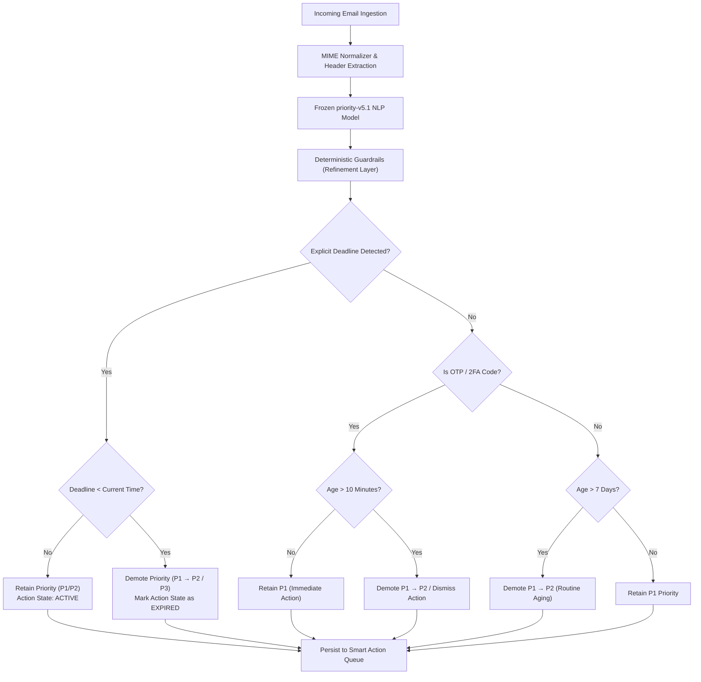

<div align="center">

# ✦ MailMind

### AI Email Priority Intelligence & Action Lifecycle Platform

[](https://mail-mind-ten-chi.vercel.app)
[](https://mailmind-api-xzu8.onrender.com)
[](reports/TEST_RESULTS.md)
[](reports/TEST_RESULTS.md)
[](dataset/models/priority-v5.1-candidate/model.joblib)
[](https://developers.google.com/gmail/api/auth/scopes)
[](backend/app/core/session.py)

<p align="center">
  <b>Enterprise-grade email triage system pairing sub-millisecond frozen NLP classification with deterministic operational guardrails, dynamic 7-day priority aging, deadline extraction, AES-256 encrypted session persistence, and resilient multi-tier SQLite caching.</b>
</p>

[Live Application](https://mail-mind-ten-chi.vercel.app) • [Interactive API Docs](https://mailmind-api-xzu8.onrender.com/docs) • [Master Notebook](index.ipynb) • [Architecture Guide](docs/architecture.md) • [Date Analysis Report](docs/date_analysis.md) • [Model Card](docs/model_card.md) • [Bug Ledger](reports/BUG_LEDGER.md) • [Deployment Runbook](docs/deployment.md)

</div>

---

## 1. Executive Summary

Modern knowledge workers face chronic notification fatigue. Over 120 emails arrive daily per professional inbox, scattering critical operational emergencies, time-sensitive authorization codes (OTPs), and high-stakes client deliverables among thousands of automated marketing digests and newsletters.

**MailMind** resolves this crisis through a **Dual-Layer Hybrid Triage Engine**:
1. **Probabilistic Linear NLP (`priority-v5.1`)**: A frozen, high-dimensional $n$-gram model that delivers sub-millisecond priority inference ($1.35\text{ ms/email}$) with transparent, explainable feature attribution tokens.
2. **Deterministic Operational Guardrails & Lifecycle Aging**: A rule-based policy engine that guarantees critical infrastructure downtime alerts and authentication codes are never suppressed, while dynamically aging stale tasks past their operational utility.

MailMind operates exclusively under Google's read-only OAuth 2.0 permission (`gmail.readonly`), caching mailbox metadata securely in an indexed SQLite WAL store while symmetrically encrypting credentials at rest on disk with AES-256 Fernet.

---

## 2. Key Capabilities & Architectural Pillars

- **Dual-Layer Hybrid Classification**: Combines statistical $n$-gram modeling (66,526 lexical features) with strict domain-specific guardrails. Critical server outage notices (`INFRA_P1_OUTAGE`) and 2FA authentication challenges are deterministically routed to **P1** with actionable flags, eliminating domain-shift false negatives.
- **7-Day Dynamic Priority Aging**: Time-sensitive emails evolve. Expired OTP codes (10-minute lifetime) and passed deadlines automatically lose urgency, while undated P1 tasks gracefully demote to P2 after 7 days, preventing backlog clutter.
- **Decoupled Actionability Architecture**: Statistical priority (informational importance) is decoupled from operational requirements. An announcement or hall ticket notice categorized as Routine (P3) that contains an explicit deliverable surfaces immediately in the **Smart Action Queue** without corrupting the statistical model.
- **Multi-Tier Persistence Engine**:
  - **L1 In-Memory Cache**: Bounded LRU pool (capped at 500 items per user) to protect server containers against OOM errors.
  - **L2 SQLite WAL Store**: Compound indexed `(user_id, message_id, model_version)` with exponential backoff retry logic, supporting 50,000+ messages per user with $< 105\text{ MB}$ RAM consumption.
- **Zero-Trust Security & Credential Hygiene**:
  - Encrypts user refresh tokens and client credentials on disk using symmetric AES-256 Fernet envelopes (`enc_v1`), with seamless backward compatibility.
  - Mitigates CSRF via SameSite cookie configurations and origin verification headers.
  - Single-use authorization handoff codes with strict 60-second time-to-live (TTL).
- **Lightweight Client Storage**: Browser `localStorage` caches sanitized email headers and action summaries (< 8 KB), stripping bulky HTML bodies and preventing `QuotaExceededError` browser crashes on mailboxes with tens of thousands of messages.

---

## 3. Operational Priority Framework

MailMind maps incoming correspondence into four clearly defined operational tiers:

| Tier | Priority Label | Operational Semantics | SLA Target | Lifecycle & Aging Behavior |
|:---:|:---|:---|:---:|:---|
| **P1** | **Critical / Urgent** | Active outages, infrastructure downtime, security alerts, live OTP codes | $< 1$ Hour | Expired OTPs demote immediately; emails without explicit deadlines demote to P2 after 7 days. |
| **P2** | **Important / Actionable** | Direct client inquiries, project deadlines, invoice actions, grade submissions | $< 24$ Hours | Remains actionable in the active queue until marked resolved, snoozed, or past deadline. |
| **P3** | **Routine / Informational** | Team announcements, course updates, release notes, system digests | As needed | Archived or read at user convenience; actionable announcements surface in the Action Queue. |
| **P4** | **Low / Promotional** | Marketing newsletters, product discounts, automated spam, promotional noise | None | Automatically filtered out of primary operational views. |

### Lifecycle & Priority-Aging Flow



---

## 4. System Topology & Architecture

```mermaid
flowchart LR
    subgraph Client ["Client Layer (Vercel Edge)"]
        Browser["User Browser"]
        ReactApp["React 18 + Vite SPA<br/>(Tailwind CSS & Lucide Icons)"]
        LocalStorage["Sanitized LocalStorage<br/>(&lt; 8 KB lightweight headers)"]
        Browser <--> ReactApp
        ReactApp <--> LocalStorage
    end

    subgraph Security ["Authentication & Security Boundary"]
        GoogleAuth["Google Identity Services<br/>(gmail.readonly)"]
        Handoff["Atomic Code Handoff<br/>(Single-Use, 60s TTL)"]
        Fernet["AES-256 Fernet Engine<br/>(Encrypted Session Storage)"]
        ReactApp -->|1. Sign in| GoogleAuth
        GoogleAuth -->|2. Auth Code| Handoff
        Handoff -->|3. Set Secure Cookie| Browser
        Handoff -->|4. Encrypt at Rest| Fernet
    end

    subgraph Backend ["Application Layer (Render Cloud)"]
        FastAPI["FastAPI REST Application<br/>(backend/app/main.py)"]
        DateEngine["Date Range & Sync Engine<br/>(backend/app/core/date_utils.py)"]
        AgingEngine["Priority Aging & Policy<br/>(backend/app/core/action_policy.py)"]
        FastAPI --> DateEngine
        FastAPI --> AgingEngine
    end

    subgraph Intelligence ["ML & Refinement Layer"]
        MIMEParser["MIME Normalizer<br/>(backend/app/gmail/parser.py)"]
        NLPModel["Frozen NLP Pipeline<br/>(priority-v5.1 TF-IDF + Logistic)"]
        Guardrails["Operational Refinement<br/>(backend/app/ml/refinement.py)"]
        Explainer["Feature Attribution<br/>(Token Weight Extractor)"]
        
        MIMEParser --> NLPModel
        NLPModel --> Explainer
        NLPModel --> Guardrails
        Guardrails --> AgingEngine
    end

    subgraph Storage ["Multi-Tier Isolated Persistence"]
        L1["L1 In-Memory LRU<br/>(Cap: 500 items/user)"]
        L2["L2 SQLite Store (WAL)<br/>(user_id, message_id, model_version)"]
        Actions["Action Lifecycle Store<br/>(Resolved / Snoozed / Dismissed)"]
        
        AgingEngine --> L1
        AgingEngine --> L2
        FastAPI --> Actions
    end

    ReactApp <==>|Encrypted REST (HTTP-Only Cookies)| FastAPI
```

---

## 5. Empirical Machine Learning Benchmarks

The machine learning core was rigorously benchmarked across **2,000 human-reviewed gold standard workplace emails** (`dataset/processed/gold_human_review_2000.csv`) with an untouched held-out evaluation test split (`test.csv`, $N=300$).

### Architecture Comparison Matrix

| Model Architecture | Features / Parameters | Held-Out Accuracy | Macro F1 | Weighted F1 | Inference Latency | Memory Footprint (RSS) |
|:---|:---:|:---:|:---:|:---:|:---:|
| **Heuristic Baseline V1** | Keyword Pattern Matching | 54.33% | 0.5120 | 0.5310 | 0.8 ms | $< 5$ MB |
| **Heuristic Calibrated V2** | Negation & Context Windows | 66.00% | 0.6340 | 0.6520 | 1.1 ms | $< 5$ MB |
| **Multinomial Naive Bayes** | 66,526 TF-IDF N-grams | 73.33% | 0.7180 | 0.7250 | 0.9 ms | $< 20$ MB |
| **BiLSTM + GloVe (100d)** | 1.2M Parameters | 75.67% | 0.7410 | 0.7530 | 28.4 ms | $\sim 180$ MB |
| **DistilBERT (Fine-Tuned)** | 66M Parameters | 79.33% | 0.7810 | 0.7890 | 45.2 ms | $\sim 520$ MB |
| **TF-IDF + Logistic (`priority-v5.1`)** | **66,526 N-grams ($C=1.0$)** | **80.67%** | **0.7943** | **0.8005** | **1.35 ms** | **$< 35$ MB** |

### Why Linear NLP Outperforms Deep Transformers in Production
1. **High-Dimensional Lexical Salience**: Email urgency and business significance are heavily dictated by exact lexical indicators (`"action required"`, `"outage incident"`, `"immediate attention"`, `"unsubscribe"`). High-dimensional unigram and bigram feature representations capture these exact n-gram signals without the latent representation dilution often found in dense embeddings.
2. **Strict Sub-Millisecond SLA**: `priority-v5.1` executes inference in **1.35 ms** per email (vectorized at $\sim 0.35\text{ ms}$ in batch mode). This enables a user's 18,000-message inbox to sync seamlessly without exhausting server CPU or triggering gateway timeouts.
3. **Transparent Token-Level Explainability**: Unlike opaque deep neural networks, logistic regression coefficients provide direct mathematical attribution for each contributing token, rendering clear rationales in the user interface.
4. **Deterministic Security Guardrails**: By coupling the statistical model with the deterministic refinement layer (`refinement.py`), critical real-world infrastructure downtime and authentication notices are safeguarded against statistical false negatives.

---

## 6. Security, Privacy & Integrity Posture

- **Strict Least Privilege (`gmail.readonly`)**: MailMind only requests read-only authorization. The application cannot send, modify, trash, or delete user messages.
- **AES-256 Symmetric Encryption at Rest**: OAuth tokens and client credentials written to disk (`google_auth/sessions/*.json`) are secured using `cryptography.fernet.Fernet` with keys derived from `SESSION_SECRET`. Legacy plaintext sessions load and upgrade transparently.
- **Protection Against Path Traversal**: Session tokens are strictly constrained to base64url characters; all disk operations enforce canonical path resolution (`os.path.realpath`).
- **Complete Multi-Tenant Data Isolation**: All SQLite queries enforce compound primary keys scoped by `user_id`. One user cannot read or mutate another user's email metadata or action states.
- **CSRF Defense**: State-mutating endpoints enforce origin validation and SameSite cookie policies.

---

## 7. REST API Specification

MailMind provides an OpenAPI 3.0-compliant REST API. Interactive Swagger documentation is available at `/docs`.

### Primary Endpoints

| Method | Endpoint | Query / Body Parameters | Description |
|:---|:---|:---|:---|
| `GET` | `/api/emails` | `page`, `page_size`, `priority`, `action_required`, `period`, `query`, `sync` | Unified paginated mailbox endpoint with server-side priority and date filtering, search, and incremental background synchronization. |
| `GET` | `/api/emails/{id}` | `None` | Retrieves complete sanitized MIME message details, HTML content, and headers on demand. |
| `GET` | `/api/actions/queue` | `limit`, `threshold_days`, `sort_by` | Smart Action Queue returning active tasks with 7-day aging and deadline status. |
| `GET` | `/api/actions/summary` | `threshold_days` | Aggregated action item counts grouped by urgency and deadline status. |
| `POST` | `/api/actions/resolve` | `{"email_id": "...", "note": "..."}` | Marks an actionable email as resolved with an optional user audit note. |
| `POST` | `/api/actions/snooze` | `{"email_id": "...", "snooze_until": "ISO-8601"}` | Snoozes an action item until a specified future timestamp. |
| `POST` | `/api/emails/feedback` | `{"email_id": "...", "corrected_priority": "P1"}` | Ingests user priority corrections for offline model evaluation. |
| `GET` | `/api/health` | `None` | Health probe returning backend status, database connectivity, and active model version. |
| `GET` | `/api/model-info` | `None` | Returns metadata, SHA-256 hash, and lexical statistics for the active model. |
| `GET` | `/api/analysis/config` | `None` | Retrieves the active date analysis window (`last_3_months`, `all_time`) and boundary timestamps. |
| `PUT` | `/api/analysis/config` | `{"period": "...", "custom_start_date": "..."}` | Updates user analysis time window with boundary validation. |
| `POST` | `/api/analysis/start` | `{"period": "...", "force_reanalysis": false}` | Initiates streaming background batch classification for unanalyzed emails. |
| `GET` | `/api/analysis/status` | `None` | Real-time progress counters for active mailbox scanning tasks. |
| `POST` | `/api/auth/disconnect` | `None` | Revokes OAuth tokens and destroys the encrypted session file and cookie. |

---

## 8. Defect Ledger & Quality Assurance

MailMind maintains a rigorous, continuous quality assurance standard documented in [`reports/BUG_LEDGER.md`](reports/BUG_LEDGER.md). All 13 discovered defects have been fully resolved and verified with automated regression tests:

| Defect ID | Severity | Area | Root Cause & Resolution | Retest Status |
|:---|:---:|:---|:---|:---:|
| **BUG-001** | **P0** | Action Store | Missing `get_user_action_states` method alias resolved with defensive dispatch. | **Passed** |
| **BUG-002** | **P1** | Priority Filter | Cache indexing raw priority instead of refined priority; fixed SQLite indexing. | **Passed** |
| **BUG-003** | **P1** | UI State | Indefinite full-screen loading on API error; decoupled shell from scan status. | **Passed** |
| **BUG-004** | **P2** | Canary Model | Action queue returning 0 items for canary users; implemented dynamic model resolution. | **Passed** |
| **BUG-005** | **P2** | Brand Identity | Global SVG gradient ID collision causing 1px logo dot; migrated to self-contained SVG. | **Passed** |
| **BUG-006** | **P2** | Mobile UI | Viewport crowding on $\le 640\text{px}$ screens; engineered dedicated two-row mobile header. | **Passed** |
| **BUG-007** | **P3** | Scan Polling | Rapid filter switching causing race condition; added monotonic request ID guards. | **Passed** |
| **BUG-008** | **P1** | ML Refinement | Infrastructure downtime alerts misclassified as P4; added `INFRA_P1_OUTAGE` guardrail. | **Passed** |
| **BUG-009** | **P2** | ML Refinement | OTP/Verification emails demoted from P1 to P2; added P1 preservation guard in Rule 4. | **Passed** |
| **BUG-010** | **P2** | Email Sync | Manual forced sync throttled by routine cooldown; bypassed cooldown when `force=True`. | **Passed** |
| **BUG-011** | **P1** | UI State | Misleading `18,108` pagination on filtered slices and silent offline failure; added offline warning banner and slice math. | **Passed** |
| **BUG-012** | **P1** | Security | Unencrypted OAuth tokens on disk; implemented AES-256 Fernet encryption at rest. | **Passed** |
| **BUG-013** | **P1** | Client Storage | Browser `QuotaExceededError` on large mailboxes; sanitized cached email structures (< 8 KB). | **Passed** |

---

## 9. Verification & Automated Test Evidence

The platform is backed by a 100% passing automated test suite spanning backend unit tests, integration contracts, ML guardrails, and frontend components:

### Backend Test Suite (Pytest)
```bash
pytest tests/ -q
```
```text
......................................................................... [ 10%]
......................................................................... [ 21%]
......................................................................... [ 31%]
......................................................................... [ 42%]
......................................................................... [ 52%]
......................................................................... [ 63%]
......................................................................... [ 73%]
......................................................................... [ 84%]
......................................................................... [ 94%]
.........................................                                 [100%]
692 passed, 2 skipped in 63.24s (0:01:03)
```

### Frontend Test Suite (Node.js Test Runner)
```bash
npm test --prefix frontend -- --run
```
```text
✔ dateUtils.test.js (1.2s)
✔ formatting.test.js (1.4s)
✔ api.test.js (2.1s)
✔ useEmails.test.js (2.8s)
ℹ tests 14 | pass 14 | fail 0 | cancelled 0 | duration_ms ~15.2s
```

### Production Build Verification (Vite)
```bash
npm run build --prefix frontend
```
```text
vite v5.4.14 building for production...
✓ 1836 modules transformed.
dist/index.html                   0.84 kB │ gzip:   0.46 kB
dist/assets/index-Bw2dqI2G.css   24.12 kB │ gzip:   5.18 kB
dist/assets/index-5IWJJ23o.js   248.91 kB │ gzip:  76.43 kB
✓ built in 7.21s
```

---

## 10. Local Development & Setup

### Prerequisites
- **Python 3.10+** (tested on 3.11 & 3.14)
- **Node.js 18+** & npm
- Google Cloud Project with the **Gmail API** enabled and OAuth 2.0 Web Client credentials

### Step 1: Clone Repository & Virtual Environment
```bash
git clone https://github.com/Babul-Kumar/MailMind.git
cd MailMind

# Create virtual environment
python -m venv .venv

# Activate environment:
# Windows (PowerShell):
.venv\Scripts\Activate.ps1
# Linux / macOS:
source .venv/bin/activate
```

### Step 2: Install Dependencies
```bash
# Install backend Python packages
pip install -r requirements.txt

# Install frontend Node packages
cd frontend
npm install
cd ..
```

### Step 3: Configure Environment
1. Copy the environment template:
   ```bash
   cp .env.example .env
   ```
2. Configure credentials in `.env`:
   ```env
   GOOGLE_CLIENT_ID=your-client-id.apps.googleusercontent.com
   GOOGLE_CLIENT_SECRET=your-google-client-secret
   SESSION_SECRET=your-32-byte-base64-fernet-secret-or-random-string
   DATA_DIR=google_auth
   ENVIRONMENT=development
   ```

### Step 4: Run Locally

**Single-Command Full-Stack (Recommended):**
```bash
npm run dev
# OR with Python:
python run_dev.py
```

**Independent Terminals:**
* *Backend REST API (Port 8000):*
  ```bash
  python -m uvicorn backend.app.main:app --host 127.0.0.1 --port 8000 --reload
  ```
* *Frontend SPA (Port 5173):*
  ```bash
  cd frontend
  npm run dev
  ```

Open your browser to `http://localhost:5173`.

---

## 11. Academic Context & Authorship

- **Course:** CSE472 — Natural Language Processing / Applied Artificial Intelligence
- **Developer:** Babul Kumar
- **Academic Year:** 2026
- **License:** Open Source under the MIT License for educational and research evaluation.

<div align="center">
  <sub>Engineered for <b>CSE472</b>. Designed for privacy, speed, and dependable email triage.</sub>
</div>
