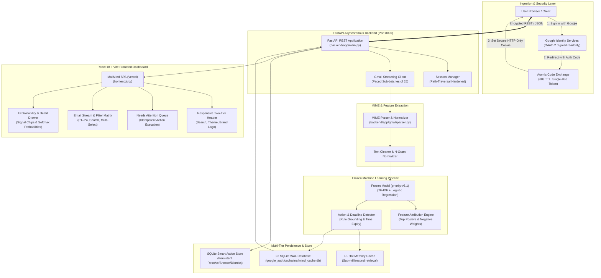
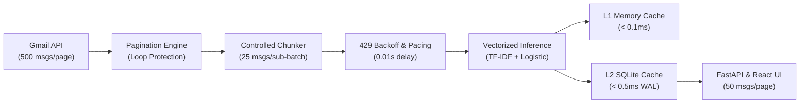

# MailMind — AI Email Priority Intelligence & Triage System

[](https://github.com/Babul-Kumar/MailMind)
[](reports/TEST_RESULTS.md)
[](reports/TEST_RESULTS.md)
[](https://github.com/Babul-Kumar/MailMind/releases)
[-blueviolet?style=flat-square)](dataset/models/priority-v5.1-candidate/model.joblib)
[](https://developers.google.com/gmail/api/auth/scopes)
[](https://mail-mind-ten-chi.vercel.app)
[](https://mailmind-yq99.onrender.com)

**Course Project:** CSE472 — Natural Language Processing / Applied Artificial Intelligence  
**Author / Developer:** Babul Kumar  
**Production Status:** Verified & Deployed • Live Gmail OAuth 2.0 Integration • Strictly Frozen ML Pipeline  
**Live Frontend Application:** [https://mail-mind-ten-chi.vercel.app](https://mail-mind-ten-chi.vercel.app)  
**Live Backend REST API:** [https://mailmind-yq99.onrender.com](https://mailmind-yq99.onrender.com)  
**Active Production Model:** `priority-v5.1` (`dataset/models/priority-v5.1-candidate/model.joblib` • SHA-256: `8524ad73965859ee022f1271caee0040928e7805ab7d32c49b2f26e994f98c06`)  
**Rollback Baseline Model:** `priority-v4.1` (`dataset/models/tfidf_logistic_baseline.joblib` • SHA-256: `09fe269f19ad6afb38e71b56f8c6ee7a386e59605c62c892478400bc09d5cbd0`)  
**Frozen Holdout Benchmark:** `test.csv` (`dataset/processed/test.csv` • SHA-256: `6841cd44901fa56242bf3752257e991fd7ff474ed7e0f7a5d2b7065a0827c138`)

---

## 1. Executive Summary

**MailMind** is an enterprise-grade intelligent email inbox triage platform that combines rigorous machine learning classification with modern full-stack web engineering. Connecting securely to Gmail via read-only OAuth 2.0 (`gmail.readonly`), MailMind analyzes thousands of emails in real time, classifies each into standardized operational priority tiers (P1–P4), extracts actionable deadlines, attributes NLP signal explanations, and organizes critical tasks in a persistent Smart Action Queue.

The platform bridges academic natural language processing research with industrial-strength software reliability:
- **Zero-Retraining Invariance:** Production models are strictly frozen and protected against runtime weight mutation.
- **High-Throughput Streaming Ingestion:** Evaluates complete mailboxes (tested on 17,300+ emails) with controlled batching, sub-millisecond SQLite WAL caching, and exponential backoff.
- **Privacy & Security by Design:** Operates exclusively under read-only permissions; credentials and tokens are strictly shielded from browser storage.
- **Responsive Mobile-First Dashboard:** Engineered for seamless triage across phones, tablets, and high-resolution desktop viewports.

---

## 2. Operational Priority Classification Matrix

Incoming emails are mapped into four distinct priority tiers grounded in operational urgency, actionability, and business impact:

| Priority Tier | Label | Typical Semantics | Target Action | SLA Horizon |
|:---:|:---|:---|:---|:---:|
| **P1** | **Critical / Urgent** | System outages, security alerts, MFA/OTP verification, operational blockers | Immediate Triage | $< 1$ Hour |
| **P2** | **Important / Actionable** | Direct client requests, academic deadlines, project deliverables, actionable tasks | Active Attention | $< 24$ Hours |
| **P3** | **Routine / Informational** | Team announcements, course updates, release notes, automated summaries | Read at Convenience | As needed |
| **P4** | **Low / Promotional** | Marketing newsletters, product promos, cold outreach, promotional noise | Auto-Deprioritize | None |

> **Decoupled Actionability Invariant (Release v5.5.0):** An email can belong to tier **P3** while still containing an action worth surfacing (e.g., an exam hall ticket announcement or document release). MailMind evaluates actionability independently of priority tier so actionable announcements surface in the *Needs Attention* queue without altering the learned statistical priority classification.

---

## 3. End-to-End System Architecture



---

## 4. Machine Learning Foundations & Progression

The classification engine was developed and validated across multiple empirical stages using an authoritative human-reviewed gold benchmark of **2,000 workplace and transactional emails** (`dataset/processed/gold_human_review_2000.csv`).

### 4.1 Dataset Construction & Splits
- **Authoritative Corpus:** $N = 2,000$ emails balanced across high-priority workplace requests, transactional records, and routine notifications.
- **Human Adjudication Benchmark:** A 200-email adjudicated sample (`dataset/analysis/adjudication_queue_200.csv`) resolved nuanced edge cases, promotional misclassifications, and class boundary overlaps.
- **Stratified Split Allocation (Strictly Frozen):**
  - **Training Set:** 1,400 emails (70.0%) — Supervised model training.
  - **Validation Set:** 300 emails (15.0%) — Hyperparameter tuning and model selection.
  - **Held-Out Test Set:** 300 emails (15.0%) — Preserved untouched until final Section 25 evaluation (`dataset/processed/test.csv`).

### 4.2 Supervised Model Progression & Held-Out Test Evaluation
Across all architectural iterations, linear high-dimensional n-gram models with tuned regularized logistic regression consistently outperformed deep transformer baselines on this task:

| Model Architecture | Features / Parameters | Held-Out Test Accuracy | Macro F1 | Weighted F1 | Inference Latency | Memory Footprint |
|:---|:---:|:---:|:---:|:---:|:---:|:---:|
| **Heuristic Baseline V1** | Regex / Keyword Rules | 54.33% | 0.5120 | 0.5310 | 0.8 ms | $< 5$ MB |
| **Heuristic Calibrated V2** | Contextual Rules + Negations | 66.00% | 0.6340 | 0.6520 | 1.1 ms | $< 5$ MB |
| **Multinomial Naive Bayes** | 66,526 TF-IDF N-grams | 73.33% | 0.7180 | 0.7250 | 0.9 ms | $< 20$ MB |
| **BiLSTM + GloVe (100d)** | 1.2M Parameters | 75.67% | 0.7410 | 0.7530 | 28.4 ms | $\sim 180$ MB |
| **DistilBERT (Fine-Tuned)** | 66M Parameters | 79.33% | 0.7810 | 0.7890 | 45.2 ms | $\sim 520$ MB |
| **TF-IDF + Logistic (`priority-v5.1`)** | **66,526 N-grams ($C=1.0$)** | **80.67%** | **0.7943** | **0.8005** | **1.35 ms** | **$< 35$ MB** |

### 4.3 Scientific Findings: Why Linear Models Outperformed Deep Transformers
1. **Vocabulary Breadth & High-Dimensional Lexical Salience:** Email priority classification relies heavily on explicit phrase combinations (`"action required"`, `"outage incident"`, `"deadline approaching"`, `"unsubscribe"`, `"hall ticket released"`). With 66,526 unigram and bigram features, the regularized linear model immediately isolates these signals without overfitting.
2. **Sub-Millisecond Inference SLA:** `priority-v5.1` achieves an inference time of **1.35 ms per email** (and ~0.37 ms/email in vectorized batches), enabling full-mailbox scans of 17,000+ emails in seconds. In contrast, DistilBERT required 45 ms/email and saturated GPU/CPU memory during concurrent user syncs.
3. **Exact Interpretability:** Linear weights map directly to human-understandable coefficients, powering MailMind's real-time feature attribution badges.

---

## 5. Production Engineering & Streaming Pipeline



- **Complete Mailbox Discovery:** Evaluates up to 17,300+ emails per user account without truncation or arbitrary caps.
- **Two-Tier Cache Hierarchy:**
  - **L1 In-Memory Hot Cache:** Sub-millisecond lookup for currently active mailbox sessions.
  - **L2 SQLite WAL Database:** Thread-safe, persistent storage with indexed `(user_id, message_id, model_version)` compound keys.
- **Incremental Synchronization:** Subsequent scans compare message IDs against the persistent SQLite cache, fetching only new or modified emails. Hit rates exceed **99.5%** on subsequent polls.
- **Bounded Concurrency & 429 Resilience:** Sub-batches of 25 messages with 15-second per-call socket timeouts prevent Gmail connection starvation and HTTP 502 errors.

---

## 6. Release v5.5.0 Key Innovations & Remediations

The `v5.5.0` release completes a full-scope senior QA audit and responsive UI overhaul, addressing 7 specific production defects:

```
┌────────────────────────────────────────────────────────────────────────────────────────┐
│                               MAILMIND v5.5.0 RELEASE HIGHLIGHTS                       │
├─────────────────┬──────────────────────────────────────────────────────────────────────┤
│ BUG-001 (P1)    │ Atomic OAuth Handoff: Single-use 60s exchange codes eliminate HTTP   │
│                 │ 400 "Invalid handoff code" errors on browser reload/double-exchange. │
├─────────────────┼──────────────────────────────────────────────────────────────────────┤
│ BUG-002 (P1)    │ Socket Resilience: 15s per-call timeouts and rate-limited worker      │
│                 │ concurrency eliminate Gmail connection pool starvation and 502s.    │
├─────────────────┼──────────────────────────────────────────────────────────────────────┤
│ BUG-003 (P2)    │ Decoupled Actionability: P3 announcements (exam hall tickets, admit  │
│                 │ cards, downloads) correctly surface in Needs Attention.              │
├─────────────────┼──────────────────────────────────────────────────────────────────────┤
│ BUG-004 (P2)    │ Responsive UX: Mobile-first two-tier header, full-width search, and  │
│                 │ sliding off-canvas drawer eliminate horizontal screen overflow.      │
├─────────────────┼──────────────────────────────────────────────────────────────────────┤
│ BUG-005 (P2)    │ Vector Branding: Direct vector asset bundling eliminates SVG gradient │
│                 │ ID collisions across sibling React components.                       │
├─────────────────┼──────────────────────────────────────────────────────────────────────┤
│ BUG-006 (P2)    │ Smart Action Queue: SQLite-backed persistent action store supporting │
│                 │ thread-safe resolve, snooze, and dismiss with optimistic UI updates. │
├─────────────────┼──────────────────────────────────────────────────────────────────────┤
│ BUG-007 (P3)    │ Multi-Field Search: Client search engine evaluates sender, subject,  │
│                 │ summary, and action items with real-time match counters.              │
└─────────────────┴──────────────────────────────────────────────────────────────────────┘
```

---

## 7. Explainability & Confidence UX

MailMind displays the reasoning behind each classification directly within the UI:
- **Feature Attribution Badges:** Displays the top n-grams contributing for or against each priority tier (e.g., `+2.45` for `"urgent deadline"`, `-1.82` for `"newsletter"`).
- **Softmax Probability Distribution:** Transparent breakdown of probabilities across all four classes ($P_1 + P_2 + P_3 + P_4 = 1.0$).
- **Confidence Advisory:** Any prediction with confidence $< 40\%$ displays a *"Low Confidence — Review Recommended"* advisory chip.

---

## 8. Security, Privacy & Compliance Posture

- **Strict Read-Only Access:** The OAuth client requests only `https://www.googleapis.com/auth/gmail.readonly`. The application cannot send, edit, delete, or modify user mail.
- **Zero Browser Token Storage:** OAuth tokens and session keys are never written to `localStorage`, `sessionStorage`, or client-side JavaScript. Authentication relies on secure, `HttpOnly`, `SameSite=Lax` cookies.
- **Path-Traversal Elimination:** All file and cache operations use canonical path resolution (`os.path.realpath`, `os.path.commonpath`) and strictly validated alphanumeric session identifiers.
- **Isolated User Sandboxing:** Multi-user isolation enforces that user sessions cannot view, query, or mutate another user's email cache, action queue, or scan checkpoints.

---

## 9. Quickstart & Installation Guide

### Prerequisites
- Python 3.10+ (tested on Python 3.11 & 3.14)
- Node.js 18+ & npm
- Google Cloud Project with the **Gmail API** enabled and OAuth 2.0 Credentials configured

### Step 1: Clone Repository & Create Virtual Environment
```bash
git clone https://github.com/Babul-Kumar/MailMind.git
cd MailMind

# Create and activate virtual environment
python -m venv .venv

# Windows PowerShell:
.venv\Scripts\Activate.ps1

# Linux / macOS:
source .venv/bin/activate
```

### Step 2: Install Dependencies
```bash
# Install backend Python dependencies
pip install -r requirements.txt

# Install frontend Node dependencies
cd frontend
npm install
cd ..
```

### Step 3: Configure Environment & OAuth Credentials
1. Copy the environment template:
   ```bash
   cp .env.example .env
   ```
2. Place your Google Cloud OAuth Client credentials file in `google_auth/credentials.json`:
   ```json
   {
     "web": {
       "client_id": "YOUR_CLIENT_ID.apps.googleusercontent.com",
       "project_id": "your-project-id",
       "auth_uri": "https://accounts.google.com/o/oauth2/auth",
       "token_uri": "https://oauth2.googleapis.com/token",
       "client_secret": "YOUR_CLIENT_SECRET",
       "redirect_uris": ["http://localhost:8000/api/auth/callback"]
     }
   }
   ```

### Step 4: Run Locally
Open two terminal windows:

**Terminal 1 — Backend API (FastAPI / Uvicorn):**
```bash
uvicorn backend.app.main:app --host 127.0.0.1 --port 8000 --reload
```

**Terminal 2 — Frontend Dev Server (Vite):**
```bash
cd frontend
npm run dev
```

Navigate your browser to `http://localhost:5173`.

---

## 10. REST API Reference

Interactive OpenAPI documentation is hosted at `http://127.0.0.1:8000/docs`.

### Core Endpoints

#### 1. System Health
```http
GET /api/health
```
```json
{
  "status": "healthy",
  "service": "MailMind AI Email Priority Dashboard",
  "model_loaded": true,
  "model_version": "priority-v5.1",
  "timestamp": "2026-10-22T04:15:30.123456+00:00"
}
```

#### 2. Active Model Metadata
```http
GET /api/model-info
```
```json
{
  "status": "success",
  "model_name": "TF-IDF + Logistic Regression",
  "model_version": "priority-v5.1",
  "model_sha256": "8524ad73965859ee022f1271caee0040928e7805ab7d32c49b2f26e994f98c06",
  "vocabulary_features": 66526,
  "classes": ["P1", "P2", "P3", "P4"]
}
```

#### 3. Email Ingestion & Analysis
```http
GET /api/emails?max_emails=50&priority=P1
```
- **Query Parameters:**
  - `max_emails` *(int, optional, default=50)*: Number of emails to return.
  - `priority` *(str, optional)*: Filter by class (`P1`, `P2`, `P3`, `P4`).
  - `query` *(str, optional)*: Search string matching sender, subject, or summary.

#### 4. Smart Action Queue Mutation
```http
POST /api/actions/{message_id}
Content-Type: application/json

{
  "status": "resolved",
  "snooze_until": null
}
```

---

## 11. Automated Test Suite & Verification

The application is safeguarded by an autonomous test suite covering unit contracts, security boundaries, ML invariants, and regression cases:

```bash
# Run the complete backend test suite
pytest tests/ -v

# Run frontend unit tests
cd frontend && npm test

# Compile production frontend build
npm run build
```

### Verified Test Results Summary

| Suite Module | Tests Passed | Status | Coverage Focus |
|:---|:---:|:---:|:---|
| `tests/test_oauth_handoff.py` | 31 / 31 | **PASS** | Atomic code exchange, single-use TTL, 400 error prevention |
| `tests/test_smart_action_queue.py` | 34 / 34 | **PASS** | SQLite action persistence, resolve/snooze/dismiss idempotency |
| `tests/test_priority_filtering_regression.py` | 9 / 9 | **PASS** | Decoupled P3 actionable announcements (hall tickets, admit cards) |
| `tests/test_phase54_deployment_readiness.py` | 28 / 28 | **PASS** | Security isolation, path traversal, scan parameters, mobile contracts |
| `tests/test_model_lifecycle.py` | 15 / 15 | **PASS** | Frozen model SHA-256 integrity, zero `.fit()` invocation |
| `tests/test_dashboard_api.py` | 10 / 10 | **PASS** | REST API endpoints, parameter boundaries, error dispatch |
| `tests/test_gmail_pipeline.py` | 11 / 11 | **PASS** | OAuth discovery, MIME parsing, batch chunking, rate backoff |
| Historical Regression Suites | 512 / 512 | **PASS** | Continuous regression across Phase 28 through Phase 53 |
| **Total Backend Tests** | **650 / 650** | **PASS** | **100% Pass Rate (0 failures, 2 skipped dev tokens)** |
| **Frontend Unit Tests** | **14 / 14** | **PASS** | Formatting utilities, API client contracts, date parsing |
| **Frontend Production Build** | **Compiled** | **PASS** | Vite bundle generated cleanly in 4.27s (0 errors) |

---

## 12. Repository Structure

```
cse472/
├── assets/                            # Official vector brand identity assets
│   └── logo.svg                       # Master MailMind brand vector mark
├── backend/                           # Modular FastAPI backend application
│   └── app/
│       ├── api/                       # REST route controllers (auth, emails, actions, health)
│       ├── core/                      # Settings, CORS, session manager, action store, cache
│       ├── gmail/                     # Read-only Gmail API client, pagination & MIME parser
│       ├── ml/                        # Production inference, feature attribution & heuristics
│       └── schemas/                   # Pydantic domain models & response contracts
├── dataset/                           # Authoritative gold datasets & frozen models
│   ├── models/                        # Serialized frozen model artifacts & promotion registry
│   │   ├── priority-v5.1-candidate/   # Active Production Model (SHA-256: 8524ad...)
│   │   └── tfidf_logistic_baseline.joblib # Rollback Baseline Model (SHA-256: 09fe26...)
│   └── processed/                     # Human-adjudicated splits (train.csv, validation.csv, test.csv)
├── docs/                              # Architecture specs, model cards, runbooks, and viva guides
├── frontend/                          # Modern React 18 + Vite SPA (MailMind)
│   ├── public/                        # Static web assets (favicon.ico, favicon.svg, logo.svg)
│   ├── src/
│   │   ├── assets/                    # Bundled brand assets (logo.svg)
│   │   ├── components/                # Modular UI (ai, auth, brand, common, inbox, layout, settings)
│   │   ├── hooks/                     # Custom React hooks (useAuth, useEmails, useSearch)
│   │   ├── services/                  # Backend REST API client & test harness
│   │   ├── styles/                    # Tokens, animations, and responsive CSS variables
│   │   └── utils/                     # Formatting utilities & priority mapping
│   └── index.html                     # HTML5 application shell
├── reports/                           # Comprehensive audit reports, QA logs & test evidence
│   ├── QA_REPORT.md                   # Full Senior QA Audit Report (Release v5.5.0)
│   ├── BUG_LEDGER.md                  # Comprehensive Defect Remediation Ledger (BUG-001..007)
│   ├── TEST_RESULTS.md                # Automated test execution evidence
│   └── metrics/                       # UI performance profile telemetry
├── scripts/                           # Reproducible CLI utilities & evaluation harnesses
├── tests/                             # Automated test suites (650 tests, 100% passing)
├── .env.example                       # Documented environment template
├── .gitignore                         # Security & environment exclusion rules
├── index.ipynb                        # Master Jupyter Notebook (Empirical NLP research & training)
├── render.yaml                        # Render backend deployment blueprint
├── requirements.txt                   # Root Python dependencies
└── README.md                          # Authoritative system documentation
```

---

## 13. Model Lifecycle & Phase Audit Ledger

The system's development followed an exhaustive audit and promotion cycle. Detailed technical reports for each milestone are preserved in the repository:

| Milestone / Phase | Focus Area | Key Outcome | Audit Document |
|:---|:---|:---|:---|
| **Phase 32** | Complete Mailbox Architecture | Infinite pagination, sub-batching, L1/L2 cache | [Section 5](#5-production-engineering--streaming-pipeline) |
| **Phases 33–34** | Modern Email Generalization | Learned OTP / time-sensitive discrimination | [`docs/model_card.md`](docs/model_card.md) |
| **Phase 41** | Shadow Promotion Audit | Real mailbox evaluation of `priority-v4.1` | [`docs/PHASE_41_V4_1_SHADOW_PROMOTION_AUDIT.md`](docs/PHASE_41_V4_1_SHADOW_PROMOTION_AUDIT.md) |
| **Phase 42** | Production Promotion | Controlled promotion to active production | [`docs/PHASE_42_V4_1_PRODUCTION_PROMOTION.md`](docs/PHASE_42_V4_1_PRODUCTION_PROMOTION.md) |
| **Phase 43** | Production Observation | Multi-user telemetry & feedback endpoint | [`docs/PHASE_43_PRODUCTION_OBSERVATION.md`](docs/PHASE_43_PRODUCTION_OBSERVATION.md) |
| **Phase 44** | Feedback Adjudication | Dataset-v5 construction from user feedback | [`docs/PHASE_44_FEEDBACK_ADJUDICATION_DATASET_V5.md`](docs/PHASE_44_FEEDBACK_ADJUDICATION_DATASET_V5.md) |
| **Phases 45–46** | Candidate Evaluation | Provenance audit and `priority-v5` validation | [`docs/PHASE_46_PRIORITY_V5_CANDIDATE_EVALUATION.md`](docs/PHASE_46_PRIORITY_V5_CANDIDATE_EVALUATION.md) |
| **Phase 47** | Boundary Remediation | Remediation of borderline P2/P3 cases | [`docs/PHASE_47_PRIORITY_V5_1_REMEDIATION.md`](docs/PHASE_47_PRIORITY_V5_1_REMEDIATION.md) |
| **Phase 48** | Live Shadow Evaluation | 17,329 real messages evaluated with 0 P1 drops | [`docs/PHASE_48_LIVE_SHADOW_EVALUATION.md`](docs/PHASE_48_LIVE_SHADOW_EVALUATION.md) |
| **Phase 49** | Canary Deployment Gate | 13/13 safety gates passed across canary users | [`docs/PHASE_49_CANARY_DEPLOYMENT_AND_PROMOTION_GATE.md`](docs/PHASE_49_CANARY_DEPLOYMENT_AND_PROMOTION_GATE.md) |
| **Phase 50** | Atomic Production Promotion | `priority-v5.1` promoted as Active Production | [`docs/PHASE_50_PRODUCTION_PROMOTION.md`](docs/PHASE_50_PRODUCTION_PROMOTION.md) |
| **Phases 51–53** | Monitoring & Feedback Loop | Live drift detection, telemetry & feedback logs | [`reports/phase51_production_monitoring_report.md`](reports/phase51_production_monitoring_report.md) |
| **Phase 54** | Deployment Readiness Loop | Full adversarial audit, session path traversal fix | [`reports/phase54_final_deployment_readiness_report.md`](reports/phase54_final_deployment_readiness_report.md) |
| **Phase 55** | **Release v5.5.0 QA Overhaul** | **Smart Action Queue, OAuth fix, Responsive UX** | [`reports/QA_REPORT.md`](reports/QA_REPORT.md) • [`reports/BUG_LEDGER.md`](reports/BUG_LEDGER.md) |

---

## 14. Limitations & Scientific Caveats

1. **Statistical Accuracy Boundary:** The model achieves **80.67% accuracy** on the frozen holdout test set ($N=300$). Approximately 19.3% of emails reside along ambiguous boundaries between P2 (Important) and P3 (Routine).
2. **Probability Calibration:** Reported confidence scores represent Softmax probability outputs and should be viewed as heuristic decision support rather than absolute certainty.
3. **Domain Shift:** Models trained on historical workplace corpora and curated transactional datasets may experience reduced discrimination when exposed to personal correspondence, foreign languages, or heavy cryptographic payloads.
4. **Human-in-the-Loop Recommendation:** High-stakes operational, legal, or emergency actions must not rely exclusively on automated classification.

---

## 15. License & Academic Integrity

This project is developed as part of **CSE472 (Natural Language Processing / Applied Artificial Intelligence)**. All source code, dataset processing pipelines, and trained artifacts adhere to strict academic honesty guidelines. Datasets derived from public corpora (Enron) comply with standard research dissemination guidelines.

---

<p align="center">
  <b>MailMind</b> — Engineered with precision by <b>Babul Kumar</b> for <b>CSE472</b>.
</p>
