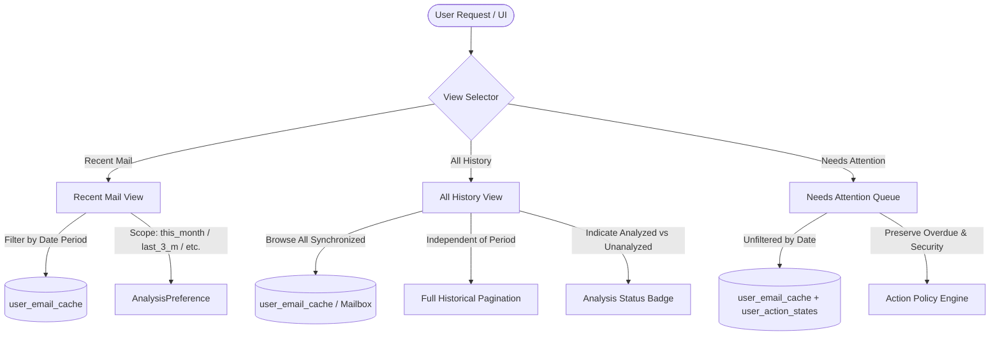

# MAILMIND — DATE-BASED EMAIL ANALYSIS AUDIT
**Document Version:** 1.0.0  
**Audit Date:** 2026-11-03  
**Auditor:** Senior Python Architect, Database Architect, and ML Systems Engineer  
**System:** MailMind Production Architecture (CSE472)

---

## 1. Executive Summary & Objective

MailMind's core capability is prioritizing incoming Gmail messages using a frozen machine learning pipeline (`priority-v5.1`) coupled with dynamic priority-aging and actionability evaluation. Currently, MailMind operates primarily across either a fixed preview slice (e.g., 20–100 messages) or a complete mailbox scan that enumerates all messages in the user's inbox without strict calendar-scoped boundaries.

This audit evaluates the current Gmail synchronization, background scanning, caching architecture, and date-time handling. It establishes the technical baseline for implementing:
1. **Date-Scoped Email Analysis** defaulting to **Last 3 Months** (with support for *This Month*, *Last 3 Months*, *Last 1 Year*, *All Time*, and *Custom Range*).
2. **Incremental ML Processing & Cache Reuse** where selecting an analysis period does not trigger re-classification of already analyzed messages or perform unnecessary full-mailbox network fetches.
3. **Tripartite Mailbox Architecture** cleanly separating:
   - **Recent Mail:** Scoped strictly to the selected analysis period.
   - **All History:** Complete chronological archive of synchronized mailbox messages, browsable with or without ML predictions.
   - **Needs Attention:** Action queue displaying all outstanding actionable items (including older unresolved security incidents and tasks) regardless of date-scope filtering.
4. **Preservation of the Frozen Production ML Model** (`priority-v5.1`, SHA-256: `8524ad73965859ee022f1271caee0040928e7805ab7d32c49b2f26e994f98c06`).

---

## 2. Existing System Architecture & Codebase Review

### 2.1 Synchronization Engine (`backend/app/gmail/scan_engine.py`)
- **Discovery Mechanism:** `discover_mailbox_message_ids()` uses the Gmail API (`users.messages.list`) with `pageToken` pagination. It accepts an optional `query` string and `label_ids`.
- **Metadata Batching:** `fetch_message_metadata_batch()` fetches batches of 25 messages using HTTP batch requests (`users.messages.get` with format `metadata`). It extracts `From`, `To`, `Cc`, `Subject`, `Date`, and internal timestamp `internalDate`.
- **Current Scan Execution:** `MailboxScanJob` scans the mailbox in sequential batches of 100 messages. It compares message IDs against the cache and classifies newly discovered messages using `predict_batch()`.
- **Identified Limitations:**
  - `discover_mailbox_message_ids()` currently retrieves all messages across the inbox unless a custom Gmail query `q` is passed.
  - When a user changes analysis periods, there is no existing abstraction to compute Gmail query date filters (e.g., `after:YYYY/MM/DD before:YYYY/MM/DD`) to avoid discovering messages from years ago.
  - Scan state tracking (`ScanJobState`) tracks in-memory job instances with JSON persistence in `google_auth/scans/<user_id>.json`. While functional for a single ongoing scan, it does not persist multi-job history or link jobs to specific date periods.

### 2.2 Storage & Caching Layer (`backend/app/core/cache.py`)
- **Database Engine:** SQLite database located at `google_auth/cache/mailmind_cache.db`.
- **Existing Tables:**
  1. `user_email_cache`: Composite primary key `(user_id, message_id, model_version)`. Stores `internal_date` (epoch milliseconds), `date_str`, `sender`, `recipients`, `subject`, `snippet`, `body`, `content_hash`, `predicted_priority`, `action_required`, `deadline_detected`, `needs_attention`, `data_json`, `analyzed_at`, `is_stale`.
  2. `user_action_states`: Composite primary key `(user_id, message_id)`. Tracks `is_resolved`, `resolved_at`, `resolution_note`, `is_snoozed`, `snoozed_until`, `snooze_reason`.
- **Memory Management:** L1 LRU memory cache per user capped at `MAX_L1_PER_USER = 500` items, with SQLite pragmas (`cache_size = -2000`, `mmap_size = 0`, `journal_mode = WAL`) preventing OOM on 512MB RAM server instances.
- **Identified Limitations:**
  - `user_email_cache` only contains messages that were processed through ML analysis. There is no distinction between a message that has been synchronized into the mailbox metadata repository and one that has undergone ML inference.
  - `query_emails()` currently accepts filtering by `priority`, `search`, and `action_required`, but lacks native `start_ts` and `end_ts` parameters for date-range bounding at the SQL index level.
  - There is no persistent entity for user date preferences (`AnalysisPreference`) or scoped job tracking (`AnalysisJob`).

### 2.3 Priority Aging & Action Policy (`backend/app/core/action_policy.py`)
- **Priority Aging Logic:** `evaluate_priority_aging()` implements the 5 canonical priority-aging rules:
  - Rule 1: Explicit deadline passed $\rightarrow$ immediate demotion from P1.
  - Rule 2: Expired OTP or authentication code $\rightarrow$ immediate removal from active P1.
  - Rule 3: P1 without deadline $\rightarrow$ 7-day clock from original `internal_date` before demotion to P2.
  - Rule 4: Security alerts without explicit deadline demote after 7 days, but unresolved security incidents remain in *Needs Attention*.
  - Rule 5: Overdue tasks that remain actionable are marked OVERDUE and retained in active action queues.
- **Distinction Preserved:** Original ML prediction (`original_priority`), dynamic post-aging priority (`effective_priority`), and action lifecycle state (`action_status`).
- **Audit Finding:** The priority aging system is mathematically sound and strictly decoupled from the ML model. It must be preserved completely. The date range filter in Recent Mail must filter by received date, while the *Needs Attention* queue must continue surfacing actions across all dates.

---

## 3. Date Handling & Timezone Semantics

### 3.1 Date Period Specifications
All persisted timestamps are stored in UTC (either epoch milliseconds for `internal_date` or ISO 8601 UTC strings). Calendar-based period boundaries are calculated in the user's configured timezone (default: `UTC` or `Asia/Kolkata` / system local timezone):

| Period Name | Exact Semantics | Subtraction Logic | Boundary Examples (assuming `2026-11-03 21:15:00 UTC`, user in UTC) |
| :--- | :--- | :--- | :--- |
| `this_month` | 1st day of current calendar month at 00:00:00 UTC through current time | Current month start | `2026-11-01 00:00:00 UTC` to `2026-11-03 21:15:00 UTC` |
| `last_3_months` (Default) | Exact 3 calendar months prior to current timestamp through current time | Calendar-month subtraction (`relativedelta(months=3)`) | `2026-08-03 21:15:00 UTC` to `2026-11-03 21:15:00 UTC` |
| `last_1_year` | Exact 12 calendar months prior to current timestamp through current time | Calendar-year subtraction (`relativedelta(years=1)`) | `2025-11-03 21:15:00 UTC` to `2026-11-03 21:15:00 UTC` |
| `all_time` | Earliest available timestamp (Epoch 0: `1970-01-01 00:00:00 UTC`) through current time | None | `1970-01-01 00:00:00 UTC` to `2026-11-03 21:15:00 UTC` |
| `custom` | User-specified inclusive start date (00:00:00) through inclusive end date (23:59:59.999) | Explicit dates validated | `2026-09-01 00:00:00` to `2026-10-31 23:59:59.999` |

### 3.2 Subtraction Method Justification
We adopt **calendar-month subtraction** via Python's standard `dateutil.relativedelta.relativedelta(months=3)` rather than a fixed 90-day approximation. Calendar-month subtraction aligns with human expectations across months with 28, 30, and 31 days.

### 3.3 Boundary Validation Rules
1. `start_date` must not be chronologically after `end_date`.
2. `end_date` must not be in the future (relative to the current system timestamp).
3. If `start_date` or `end_date` are malformed or invalid strings, the system returns HTTP 422 Unprocessable Entity with descriptive error messaging.
4. Timezones must be validated against IANA standard timezones using `zoneinfo.ZoneInfo`.

---

## 4. Incremental Analysis & Cache Reuse Strategy

To eliminate redundant Gmail API consumption and avoid re-classifying emails:
1. **Cache Lookups by Message ID & Version:** When an analysis period is selected, the system calculates the date range `[start_ts, end_ts]`.
2. **Metadata Discovery:** Gmail API query `after:YYYY/MM/DD before:YYYY/MM/DD` is used to discover message IDs within the period.
3. **Partitioning:**
   - Discovered IDs are partitioned into:
     - $A_{\text{cached}}$: IDs already in SQLite with `model_version == active_version` and `is_stale == 0`.
     - $A_{\text{pending}}$: IDs missing from cache or marked stale.
4. **Idempotent Job Execution:**
   - If $A_{\text{pending}} = \emptyset$, analysis progress is immediately 100% and existing results are served instantly.
   - If $A_{\text{pending}} \neq \emptyset$, an `AnalysisJob` is created/resumed in `QUEUED` / `RUNNING` state.
   - Background workers fetch only $A_{\text{pending}}$ in sub-batches of 25, run inference via `predict_batch()`, and persist records in `user_email_cache`.
5. **No Full Sync Re-triggering:** Switching periods from *Last 3 Months* to *This Month* reuses 100% of the cached items with zero network calls to Gmail. Switching from *This Month* to *Last 3 Months* only fetches the delta (the preceding 2 months).

---

## 5. View Separation Architecture

1. **Recent Mail:** Displays messages with `internal_date >= start_ts AND internal_date <= end_ts`. Allows sorting, priority filtering, and pagination.
2. **All History:** Displays all messages synchronized from Gmail regardless of date scope. Shows priority badges if analyzed, or an "Unanalyzed" indicator if ML prediction has not yet run. Allows users to request analysis for specific historical items on demand.
3. **Needs Attention:** Always queries all active actions across the user's complete mailbox history. Ensures that critical tasks or security notifications from 4 months ago are never hidden simply because the user selected "This Month".

---

## 6. Model Verification & Immutability Guarantee

The production model artifact is verified:
- **Location:** `dataset/models/priority-v5.1-candidate/model.joblib`
- **Active Model Version:** `priority-v5.1`
- **Verified SHA-256:** `8524ad73965859ee022f1271caee0040928e7805ab7d32c49b2f26e994f98c06`

Under no circumstances will model training, parameter tuning, threshold changes, or LLM replacements occur during this implementation.

---

## 7. Conclusion & Next Steps

The audit confirms that the MailMind codebase possesses the robust foundation needed for date-based analysis and historical browsing. The required changes do not disrupt existing authentication or priority-aging logic. 

We will proceed directly to authoring `API_CONTRACTS.md`, `DATA_MODEL_AUDIT.md`, and `IMPLEMENTATION_PLAN.md`.

